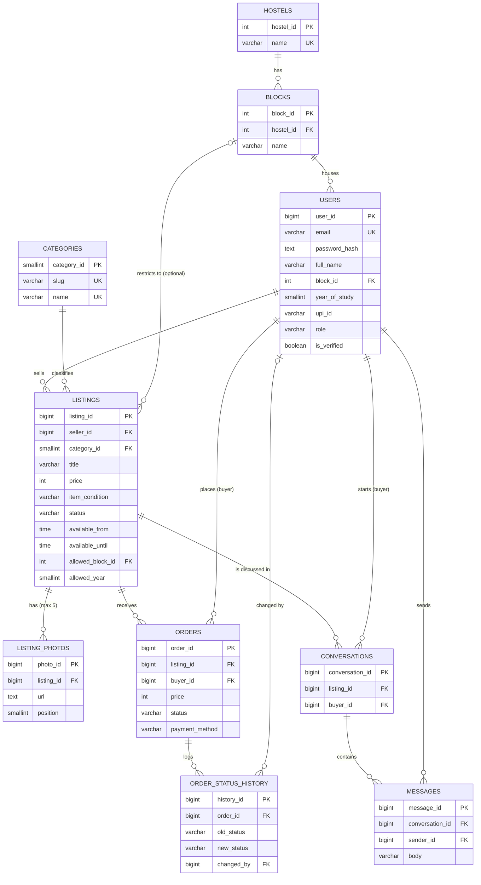

# Hostel Market: Database Design

This document follows the structure of the DBMS mini-project report (Chapter 4 and 5).
All SQL lives in [`backend/database/`](../backend/database):

| File | Report section |
|---|---|
| `01_schema.sql` | 4.2 Relational schema, 4.6 Integrity constraints, 5.1 Table creation |
| `02_functions_triggers.sql` | 5.4 Additional features: triggers, stored functions, procedures, transactions |
| `03_views.sql` | 5.4 Views |
| `04_seed.sql` | 5.2 Sample data insertion |
| `05_sample_queries.sql` | 5.3 SQL queries (joins, nested, aggregates, search) |
| `00_reset.sql` | Drops everything (Appendix A: destructive, clearly labelled) |

DBMS: **PostgreSQL 14+** (hosted, for example Neon or Supabase).

---

## 4.1 Entity-Relationship diagram



GitHub and VS Code render this diagram. For the report, paste the block into
<https://mermaid.live> and export it as PNG, or redraw it in draw.io.

Cardinalities in words:

- A **hostel** has many **blocks**; a block belongs to one hostel (1:N).
- A **block** houses many **users**; a user lives in exactly one block (1:N).
- A **user** sells many **listings** (1:N); a **category** classifies many listings (1:N).
- A **listing** has 0-5 **photos** (1:N, capped by a CHECK on `position`).
- **Users** and **listings** are in an M:N "wants to buy" relationship, resolved by **orders**.
  Each order also has its own attributes (price, status, payment method).
- A **listing** can be discussed by many buyers; each (listing, buyer) pair has one **conversation** (M:N resolved).
- A **conversation** contains many **messages**.

## 4.2 Relational schema

Primary keys are **bold**, foreign keys are in *italics*.

- HOSTELS(**hostel_id**, name, created_at)
- BLOCKS(**block_id**, *hostel_id*, name)
- USERS(**user_id**, email, password_hash, full_name, *block_id*, year_of_study, upi_id, role, is_verified, verified_at, created_at, updated_at)
- CATEGORIES(**category_id**, slug, name)
- LISTINGS(**listing_id**, *seller_id*, *category_id*, title, description, item_condition, price, status, available_from, available_until, *allowed_block_id*, allowed_year, search_doc, created_at, updated_at, removed_at)
- LISTING_PHOTOS(**photo_id**, *listing_id*, url, storage_key, position, created_at)
- ORDERS(**order_id**, *listing_id*, *buyer_id*, price, status, payment_method, buyer_note, request_expires_at, accepted_at, paid_at, handed_over_at, completed_at, closed_at, close_reason, created_at, updated_at)
- ORDER_STATUS_HISTORY(**history_id**, *order_id*, old_status, new_status, *changed_by*, note, changed_at)
- CONVERSATIONS(**conversation_id**, *listing_id*, *buyer_id*, buyer_last_read_id, seller_last_read_id, last_message_at, created_at)
- MESSAGES(**message_id**, *conversation_id*, *sender_id*, body, created_at)

Foreign keys:

| Foreign key | References | On delete |
|---|---|---|
| blocks.hostel_id | hostels.hostel_id | RESTRICT |
| users.block_id | blocks.block_id | RESTRICT |
| listings.seller_id | users.user_id | RESTRICT |
| listings.category_id | categories.category_id | RESTRICT |
| listings.allowed_block_id | blocks.block_id | SET NULL |
| listing_photos.listing_id | listings.listing_id | CASCADE |
| orders.listing_id | listings.listing_id | RESTRICT |
| orders.buyer_id | users.user_id | RESTRICT |
| order_status_history.order_id | orders.order_id | CASCADE |
| order_status_history.changed_by | users.user_id | SET NULL |
| conversations.listing_id / buyer_id | listings / users | CASCADE |
| messages.conversation_id / sender_id | conversations / users | CASCADE |

## 4.4 Data dictionary (main tables)

| Table | Attribute | Type | Constraint / description |
|---|---|---|---|
| USERS | user_id | BIGINT IDENTITY | Primary key |
| USERS | email | VARCHAR(254) | NOT NULL, UNIQUE, CHECK lower-case and contains @ |
| USERS | full_name | VARCHAR(100) | NOT NULL, CHECK not blank |
| USERS | block_id | INT | FK → BLOCKS, NOT NULL |
| USERS | year_of_study | SMALLINT | CHECK 1-6 |
| USERS | upi_id | VARCHAR(100) | CHECK regex `name@bank`; NULL = can't sell |
| USERS | role | VARCHAR(10) | DEFAULT 'student', CHECK IN ('student','admin') |
| USERS | is_verified / verified_at | BOOLEAN / TIMESTAMPTZ | CHECK both set together |
| LISTINGS | price | INT | Whole rupees, CHECK 1-1,000,000 |
| LISTINGS | item_condition | VARCHAR(10) | CHECK IN (new, like_new, good, fair, poor) |
| LISTINGS | status | VARCHAR(10) | DEFAULT 'active', CHECK IN (active, reserved, sold, removed) |
| LISTINGS | available_from / until | TIME | Optional window (IST); CHECK both or neither, and not equal |
| LISTINGS | allowed_block_id | INT | FK → BLOCKS; trigger: must be in the seller's hostel |
| LISTINGS | allowed_year | SMALLINT | CHECK 1-6 |
| LISTINGS | search_doc | TSVECTOR | GENERATED from title + description; GIN index |
| LISTING_PHOTOS | position | SMALLINT | CHECK 0-4 (max 5 photos), UNIQUE (listing_id, position) DEFERRABLE |
| ORDERS | price | INT | Price agreed at request time (snapshot) |
| ORDERS | status | VARCHAR(20) | CHECK IN (requested … expired); see state machine below |
| ORDERS | payment_method | VARCHAR(10) | CHECK IN ('upi','cash'); required once payment starts |
| MESSAGES | body | VARCHAR(2000) | CHECK not blank |

## 4.5 Normalization

**1NF**: every attribute is atomic. Photos are not stored as a list inside LISTINGS; they get
their own table LISTING_PHOTOS (one row per photo). Messages likewise get their own table.

**2NF**: every table has a single-column surrogate key, so there are no partial dependencies.
The natural composite keys are enforced as UNIQUE constraints instead: (hostel_id, name) in
BLOCKS, (listing_id, buyer_id) in CONVERSATIONS, (listing_id, position) in LISTING_PHOTOS.
Non-key attributes depend on the whole of each one. For example, a block's name depends on
(hostel, block), not on the hostel alone.

**3NF**: no transitive dependencies. Two design decisions show this:

1. *A user's hostel is not stored in USERS.* The functional dependencies are
   `user_id → block_id` and `block_id → hostel_id`. Storing `hostel_id` in USERS would add the
   transitive dependency `user_id → block_id → hostel_id`. Then a user could end up with
   block "B of Hostel 1" but hostel "Hostel 2" (an update anomaly). The hostel is always
   derived by a join (see `fn_user_hostel` and `v_user_profiles`).
2. *An order does not store the seller.* `order_id → listing_id → seller_id`, so the seller is
   derived from the listing (`v_order_details`).

**A deliberate non-redundancy: `orders.price`.** It looks like a copy of `listings.price`, but
it is a different fact: the price agreed *when the request was made*. The seller may change
the listing price later; old orders must keep their price. So it depends only on `order_id`.

**Anomalies avoided:**
- *Insertion*: a hostel and its blocks can exist before any student registers.
- *Update*: renaming a hostel is one row in HOSTELS, not one per user and per listing.
- *Deletion*: removing a listing (soft delete with `status = 'removed'`) keeps its orders and
  their history. Hard deletes are blocked by `ON DELETE RESTRICT`.

## 4.6 Integrity constraints (summary)

| Kind | Where |
|---|---|
| PRIMARY KEY | every table (identity columns) |
| FOREIGN KEY | 14 references, with RESTRICT / CASCADE / SET NULL chosen per relationship |
| UNIQUE | users.email, hostels.name, (hostel_id, name), categories.slug/name, listing_photos.storage_key, (listing_id, buyer_id) |
| NOT NULL | all required attributes |
| CHECK | ranges (year 1-6, price 1-1,000,000, photo position 0-4), enumerations (status, role, condition, payment method), formats (email, UPI ID), multi-column rules (time window pair, verified pair, removed_at ↔ status, closed_at ↔ terminal status, payment method required once paying) |
| DEFAULT | status 'active' / 'requested', role 'student', timestamps now() |
| Partial UNIQUE index | `orders_one_live_per_listing`: at most one accepted/paid order per listing (two buyers can never get the same item); `orders_one_request_per_buyer` |
| Triggers (rules a CHECK can't express) | seller must be verified and have a UPI ID; allowed block must be in the seller's hostel; buyer ≠ seller; message sender must be in the conversation |

## 5.4 Triggers, functions, procedures, views, transactions

**Order state machine** (implemented in `fn_transition_order`):

```
requested ──accept──▶ accepted ──choose_payment──▶ awaiting_payment ──confirm_payment──▶ paid ──handover──▶ handed_over ──complete──▶ completed
    │ reject / cancel / (48 h) expire        │ cancel                        │ cancel
    ▼                                        ▼                               ▼
 rejected / cancelled / expired          cancelled                       cancelled
```

| Object | Type | What it does |
|---|---|---|
| `trg_set_updated_at` | BEFORE UPDATE trigger | keeps `updated_at` current on users, listings, orders |
| `trg_listings_validate` | BEFORE INSERT/UPDATE trigger | only verified sellers with a UPI ID; allowed block in own hostel; sets `removed_at` |
| `trg_listings_close_requests` | AFTER UPDATE OF status trigger | when an item is sold/removed, rejects every waiting request |
| `trg_orders_not_own_listing` | BEFORE INSERT trigger | a user can't order their own item |
| `trg_orders_history` | AFTER INSERT/UPDATE trigger | writes every status change to ORDER_STATUS_HISTORY (audit log) |
| `trg_messages_check_sender` / `trg_messages_touch_conversation` | triggers | only participants can post; updates last-message time and read pointer |
| `fn_buy_block_reason(listing, buyer)` | function | returns why a buyer can't buy (hostel, block, year, time window …) or NULL |
| `fn_request_order(...)` | function (transaction) | locks the listing row (`SELECT … FOR UPDATE`), checks eligibility, inserts the order |
| `fn_transition_order(...)` | function (transaction) | the whole state machine; locks listing then order, so concurrent actions can't deadlock |
| `fn_expire_requests()` | function | expires unanswered requests (run every minute by the API) |
| `fn_open_conversation(...)` | function | starts or returns the buyer-seller chat |
| `sp_set_user_verified` | procedure (`CALL`) | admin verifies a user |
| `sp_admin_remove_listing` | procedure (`CALL`) | admin takedown: cancels the live order, then removes the listing |
| `v_user_profiles`, `v_listing_cards`, `v_order_details` | views | ready-made joins used by the API |
| `v_seller_stats`, `v_hostel_category_summary` | views | aggregates (COUNT … FILTER, SUM, AVG, GROUP BY) for profile and admin pages |

**Concurrency example for the report.** Two sellers' clicks cannot sell one item twice:
`fn_transition_order` takes a row lock on the listing (`FOR UPDATE`), so a second "accept"
waits, then sees `status = 'reserved'` and fails with `listing_reserved`. Even a hand-written
`UPDATE` is stopped by the partial unique index `orders_one_live_per_listing`.

**Indexes:** B-tree indexes on every foreign key used in joins, partial indexes for the
active-listing feed (`WHERE status = 'active'`), a GIN index for full-text search, and a partial
index on unanswered requests for the expiry job.

## Mapping the app to the report's test cases (Chapter 6)

`backend/tests/test_api.py` is an executable version of the test-case table. A few examples:

| Test | Expected result | Test function |
|---|---|---|
| Register with an existing email | UNIQUE violation → 409 `email_taken` | `test_duplicate_email_and_bad_block` |
| Unverified user creates a listing | trigger → 403 `not_verified` | `test_who_can_sell` |
| Buyer from another hostel requests an item | 403 `different_hostel` | `test_eligibility_rules` |
| Seller accepts a second buyer | 409 `listing_reserved` | `test_only_one_buyer_gets_the_item` |
| Full order life cycle | listing becomes `sold`, waitlist rejected, 6 history rows | `test_full_order_lifecycle` |
| Insert an order with an invalid listing | FOREIGN KEY violation | `test_database_rejects_bad_rows_directly` |
